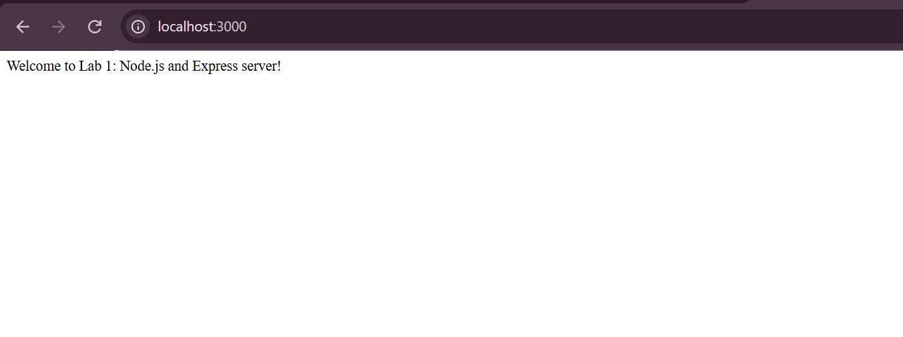
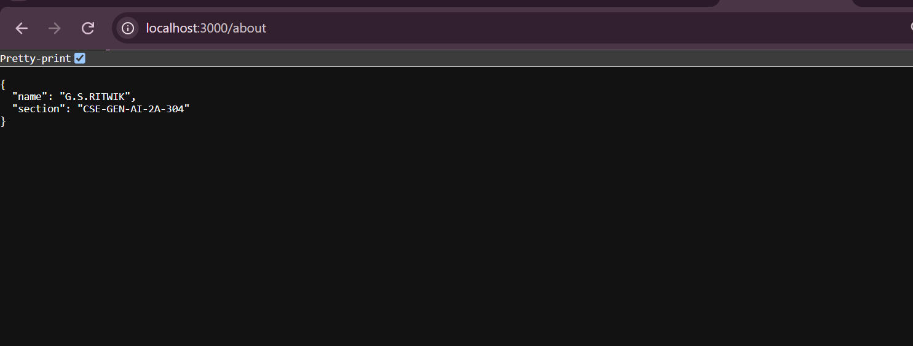
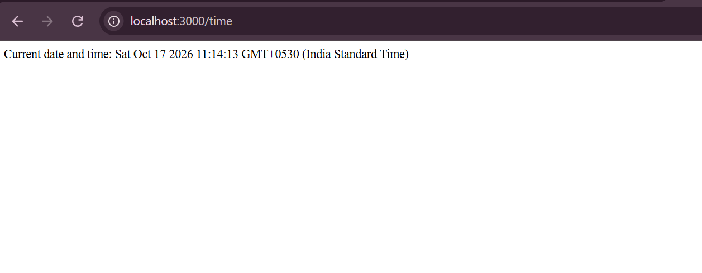
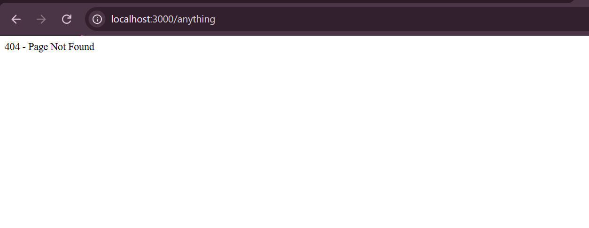

# Lab 1: Node.js and Express Server

## Student Details

- **Name:** G.S.RITWIK
- **Registration Number:** 252U1R9036
- **Section:** CSE-GEN-AI-2A-304
- **Course:** Backend Development Fundamentals
- **Lab Number:** 01

## Live Link

**Deployment URL:** https://backend-development-fundamentals-lab-01-gfii.onrender.com

*(Hosted on Render's free tier. The first request after a period of inactivity can take up to a minute while the server wakes up.)*

## Objective

To set up a Node.js project, create a basic HTTP server using the built-in `http` module, and build an Express server with multiple routes and appropriate HTTP status codes.

## Technologies Used

- Node.js
- Express.js
- JavaScript
- npm
- Visual Studio Code
- Render (deployment)

## Project Structure

```
lab-01/
├── screenshots/
│   ├── home.png
│   ├── about.png
│   ├── time.png
│   └── not-found.png
├── server-http.js
├── server.js
├── package.json
├── package-lock.json
├── .env.example
├── .gitignore
└── README.md
```

## Installation and Setup

### Prerequisites

- Node.js and npm installed
- Visual Studio Code or another code editor

### Steps to Run

1. Clone the repository or download the project.

2. Open the `lab-01` folder in the terminal.

3. Install the dependencies:

```
npm install
```

4. Start the Express server:

```
node server.js
```

5. Open the following URL in your browser:

   `http://localhost:3000`

**Environment variables:** none are required. `PORT` is optional (default `3000`); see `.env.example`. No real values are stored in the repository.

### Run the Basic HTTP Server

To run the server implemented using Node.js's built-in HTTP module:

```
node server-http.js
```

Stop the running server with `Ctrl + C` before starting another server on the same port.

## Endpoints

| Method | Endpoint    | Description                                    | Expected Status |
| ------ | ----------- | ---------------------------------------------- | --------------- |
| GET    | `/`         | Returns a welcome message                      | 200 OK          |
| GET    | `/about`    | Returns the student's name and section as JSON | 200 OK          |
| GET    | `/time`     | Returns the current date and time              | 200 OK          |
| GET    | `/anything` | Demonstrates the response for an unknown route | 404 Not Found   |

The `/anything` path is an example of an unknown route. Other undefined paths also return a 404 response.

`server-http.js` replies `Hello` on `/` (200) and a 404 message for any other path.

## Screenshots

### 1. Home Route

Displays the welcome message.



### 2. About Route

Displays the student's name and section in JSON format.



### 3. Time Route

Displays the current date and time.



### 4. Unknown Route

Displays the 404 Page Not Found response.



## HTTP Status Codes

- **200 OK:** The request was successful.
- **404 Not Found:** The requested route does not exist.

## package.json Fields

| Field          | Meaning                                          |
| -------------- | ------------------------------------------------ |
| `name`         | Project name (lowercase, no spaces)              |
| `version`      | Project version (semantic versioning)            |
| `description`  | Short summary of the project                     |
| `main`         | Entry file of the project                        |
| `scripts`      | Commands run with `npm run <name>` (`npm start`) |
| `keywords`     | Search tags for the project                      |
| `author`       | Who wrote the project                            |
| `license`      | Licence the code is shared under                 |
| `dependencies` | Packages needed at runtime (Express)             |

## Viva Questions

### 1. What is the difference between `package.json` and `node_modules`?

`package.json` stores project metadata, scripts, and dependency information. `node_modules` contains the installed packages required by the project. It can be recreated with `npm install`, so it is not committed.

### 2. What does `app.listen()` do?

`app.listen()` starts the Express server and makes it listen for incoming requests on a specified port.

### 3. What do `request` and `response` represent?

`request` contains information about the incoming HTTP request. `response` is used to send data and status codes back to the client.

## Problems Faced and Solutions

- **`npm install` failed with "Could not read package.json" (ENOENT):** The terminal was open in the outer `lab-01` folder created while extracting the zip, and the project was inside a second `lab-01` folder. I moved into the inner folder with `cd lab-01` and ran `npm install` again.
- **Deployment root folder:** On Render, the project sits inside the `lab-01` folder of the repository, so I set the Root Directory to `lab-01` so Render could find `package.json`.

## Git and Repository Notes

- The `.gitignore` file excludes `node_modules/` and `.env`.
- The `node_modules/` directory must not be committed.
- Screenshots are stored in the `screenshots/` directory.
- The project is submitted through the course GitHub repository.
