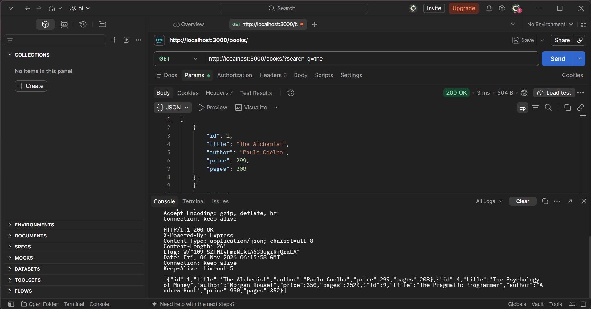
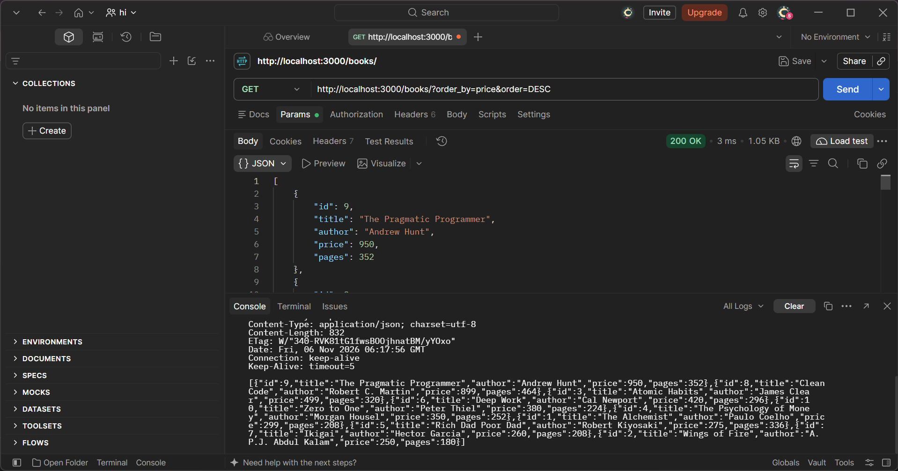
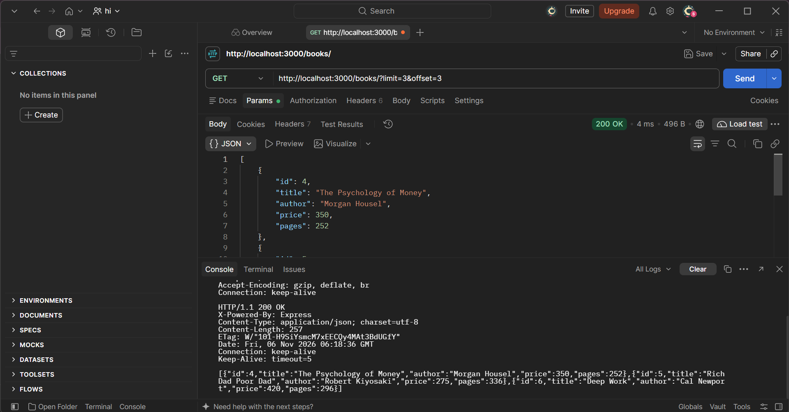
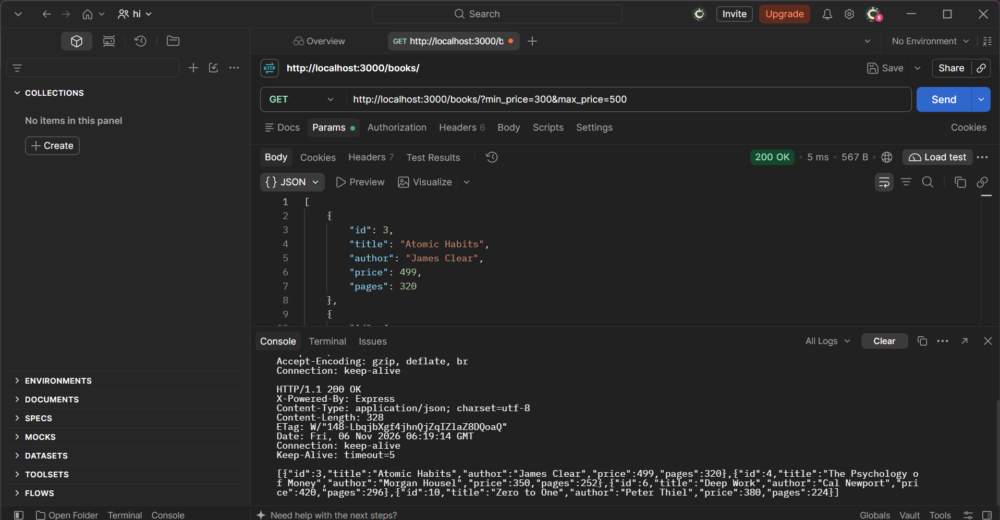
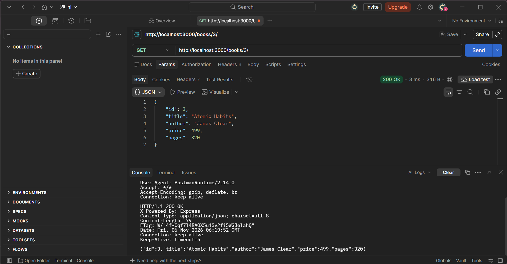
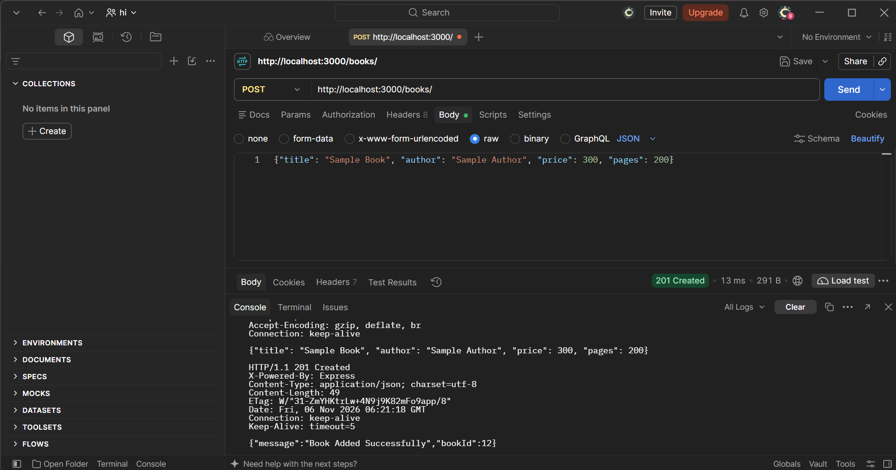
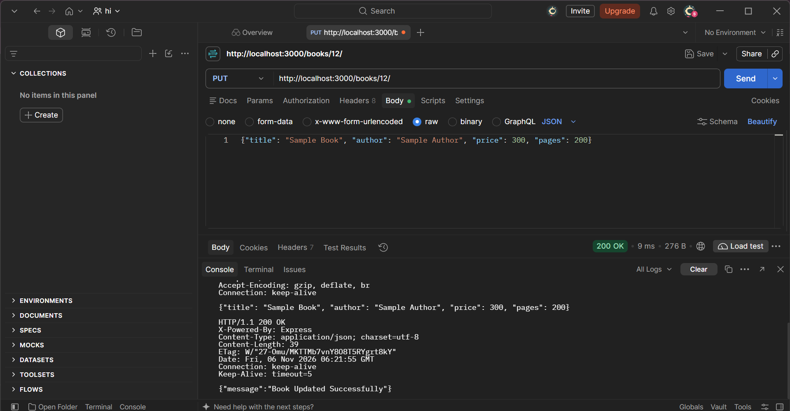
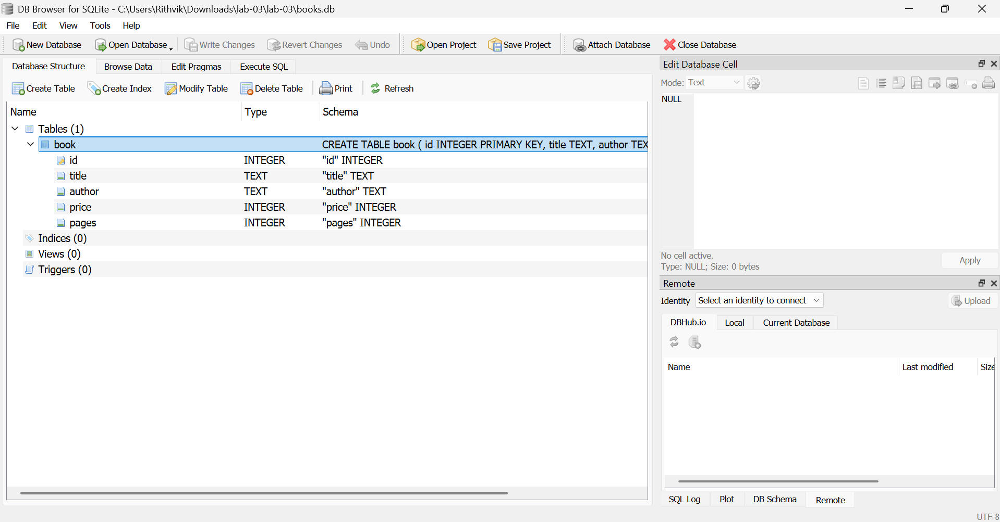

# Lab 3: REST API, query parameters, validation, debugging

- **Name:** G.S.RITWIK
- **Registration Number:** 252U1R9036
- **Section:** CSE-GEN-AI-2A-304
- **Course:** Backend Development Fundamentals
- **Lab Number:** 03

## Live Link

- **Deployment URL:** https://lab-reports-3-bfs1.onrender.com/books/
- **Get All Books:** https://lab-reports-3-bfs1.onrender.com/books/
- **Filter by Price:** https://lab-reports-3-bfs1.onrender.com/books/?min_price=250&max_price=500
- **Search:** https://lab-reports-3-bfs1.onrender.com/books/?search_q=Clean
- **Sort & Pagination:** https://lab-reports-3-bfs1.onrender.com/books/?order_by=price&order=DESC&limit=5&offset=0
- **Get Single Book:** https://lab-reports-3-bfs1.onrender.com/books/1/

*(Hosted on Render's free tier. The first request after a period of inactivity can take up to a minute while the server wakes up.)*

## Objective

Turn the Lab 2 routes into a clean REST API with search, sorting, pagination, a price filter, input validation and correct status codes, and practise debugging common errors.

## Technologies Used

Node.js, Express.js, SQLite (`sqlite` + `sqlite3`), nodemon, Postman, Visual Studio Code

## Project Structure

```
lab-03/
├── screenshots/
├── debugging/
│   └── DEBUGGING.md          # the four debugging errors and their fixes
├── postman/
│   └── lab-03.postman_collection.json   # success and failure tests
├── app.js                    # Express server, SQLite and all routes
├── books.db                  # SQLite database (table: book, 10 rows)
├── seed.sql                  # SQL that creates the table and rows
├── package.json
├── package-lock.json
├── .env.example
├── .gitignore
└── README.md
```

## How to Run

**Prerequisites:** Node.js and npm installed.

```
cd lab-03
npm install
npm run dev      # development: nodemon restarts on every change
npm start        # plain start: node app.js
```

The server runs at `http://localhost:3000/`.

**Environment variables:** none are required. `PORT` is optional (default `3000`); see `.env.example`. Never commit a real `.env` file.

## Endpoints

Endpoints are nouns (`/books`). The HTTP method shows the action.

| Method | Path              | Description                                           | Success | Errors        |
| ------ | ----------------- | ----------------------------------------------------- | ------- | ------------- |
| GET    | `/books/`         | List books with search, filter, sort and pagination   | 200     | 400, 500      |
| GET    | `/books/:bookId/` | Get one book by id                                    | 200     | 400, 404, 500 |
| POST   | `/books/`         | Add a book (JSON body)                                | 201     | 400, 500      |
| PUT    | `/books/:bookId/` | Update all fields of a book (JSON body)               | 200     | 400, 404, 500 |
| DELETE | `/books/:bookId/` | Delete a book                                         | 200     | 400, 404, 500 |

### Query parameters for `GET /books/`

All are optional and have defaults.

| Parameter   | Meaning                                         | Allowed values                       | Default |
| ----------- | ----------------------------------------------- | ------------------------------------ | ------- |
| `search_q`  | Partial title match (`LIKE`)                    | any text                             | none    |
| `min_price` | Lowest price                                    | number, 0 or more                    | none    |
| `max_price` | Highest price                                   | number, 0 or more                    | none    |
| `order_by`  | Column to sort by                               | `id`, `title`, `author`, `price`, `pages` | `id` |
| `order`     | Sort direction                                  | `ASC` or `DESC`                      | `ASC`   |
| `limit`     | Rows per page                                   | whole number, 1 to 100               | `10`    |
| `offset`    | Rows to skip                                    | whole number, 0 or more              | `0`     |

When both `min_price` and `max_price` are given, the query uses `price BETWEEN ? AND ?`. With only one of them it uses `>=` or `<=`.

Examples:

```
GET /books/?search_q=the
GET /books/?order_by=price&order=DESC
GET /books/?limit=3&offset=3
GET /books/?min_price=300&max_price=500
GET /books/?search_q=o&min_price=250&order_by=title&order=ASC&limit=5
```

### Request body for POST and PUT

```json
{
  "title": "Sample Book",
  "author": "Sample Author",
  "price": 300,
  "pages": 200
}
```

- `title` and `author` are required, non-empty strings.
- `price` is required and must be a non-negative number (a string such as `"abc"` is rejected).
- `pages` is optional, and must be a positive whole number when given.

### Response format

Every error uses the same shape:

```json
{ "message": "title is required and must be a non-empty string" }
```

Successful create, update and delete return `{ "message": "..." }` (create also returns `bookId`). The list and single-book routes return the book data.

### Status codes

| Status | When                                                                           |
| ------ | ------------------------------------------------------------------------------ |
| 200    | Successful GET, PUT or DELETE                                                  |
| 201    | Book created                                                                   |
| 400    | Bad input: invalid query parameter, invalid id, missing or invalid body field, invalid JSON |
| 404    | The book id does not exist, or the route does not exist                        |
| 500    | Unexpected server or database error                                            |

## Postman Test List

Import `postman/lab-03.postman_collection.json` into Postman (**Import**). It has a `baseUrl` variable (`http://localhost:3000`; change it to your live URL to test the deployment). Run it with the Collection Runner, in order, because request 8 saves the new id for requests 9 and 10. Each request has a test that checks the status code.

### Success cases

| #  | Request                                       | Expected |
| -- | --------------------------------------------- | -------- |
| 1  | GET `/books/` (defaults)                      | 200      |
| 2  | GET `/books/?search_q=the`                    | 200      |
| 3  | GET `/books/?order_by=price&order=DESC`       | 200      |
| 4  | GET `/books/?limit=3&offset=3`                | 200      |
| 5  | GET `/books/?min_price=300&max_price=500`     | 200      |
| 6  | GET with search, price, sort and limit together | 200    |
| 7  | GET `/books/3/`                               | 200      |
| 8  | POST `/books/` with a valid body              | 201      |
| 9  | PUT `/books/<new id>/` with a valid body      | 200      |
| 10 | DELETE `/books/<new id>/`                     | 200      |

### Failure cases

| #   | Request                                        | Expected |
| --- | ---------------------------------------------- | -------- |
| F1  | GET `/books/?order_by=color`                   | 400      |
| F2  | GET `/books/?order=sideways`                   | 400      |
| F3  | GET `/books/?limit=abc`                        | 400      |
| F4  | GET `/books/?min_price=500&max_price=100`      | 400      |
| F5  | GET `/books/?min_price=abc`                    | 400      |
| F6  | GET `/books/999/`                              | 404      |
| F7  | GET `/books/abc/`                              | 400      |
| F8  | POST without `title`                           | 400      |
| F9  | POST without `author`                          | 400      |
| F10 | POST with `"price": "abc"`                     | 400      |
| F11 | POST with invalid JSON                         | 400      |
| F12 | PUT `/books/999/` (valid body)                 | 404      |
| F13 | PUT with an empty title                        | 400      |
| F14 | DELETE `/books/999/`                           | 404      |
| F15 | GET `/nothing/`                                | 404      |

## Screenshots

Postman screenshots that prove the results (method, URL, body and status code visible).

### Search by title (`search_q`)

`GET /books/?search_q=the` returns only the books whose title contains "the".



### Sort by price (`order_by` and `order`)

`GET /books/?order_by=price&order=DESC` returns the books from the highest price to the lowest.



### Pagination (`limit` and `offset`)

`GET /books/?limit=3&offset=3` skips the first 3 books and returns the next 3.



### Price range filter (`min_price` and `max_price`)

`GET /books/?min_price=300&max_price=500` returns only books priced from 300 to 500.



### Get one book

`GET /books/3/` returns the book with id 3.



### Create a book (201 Created)

`POST /books/` with a valid JSON body returns 201 and the new `bookId`.



### Update a book (200 OK)

`PUT /books/12/` updates the book that was just created.



### Database view

The `book` table in `books.db`, opened in DB Browser for SQLite.



## Debugging Exercise

The four errors from the exercise (port conflict `EADDRINUSE`, wrong import path, table-name typo `no such table`, and a missing `await`) are explained with their fixes in [`debugging/DEBUGGING.md`](debugging/DEBUGGING.md).

## Viva Questions

### 1. What is the difference between a query parameter and a path parameter?

A path parameter is part of the URL path and identifies one resource, such as the `3` in `/books/3/`. A query parameter comes after `?` and adjusts how a collection is returned (search, sort, filter, pagination), such as `/books/?order_by=price&limit=5`. Path parameters are required to reach the route; query parameters are usually optional.

### 2. What does stateless mean?

The server keeps no memory of earlier requests from a client. Every request carries everything the server needs (URL, method, parameters, body), so any request can be handled on its own, and the server can be restarted or scaled without losing track of a "session".

### 3. Which status code for bad input and which for a missing record?

Bad input (invalid body, invalid query parameter, invalid id) returns **400 Bad Request**. A record that does not exist returns **404 Not Found**.

## Notes: Problems Faced and Solutions

- Write your own notes here. For example, describe an error you hit while testing in Postman, deploying or fixing the debugging exercise, and how you solved it.
- Column names cannot be passed as `?` placeholders in SQL, so `order_by` is checked against a fixed list of column names before it is used in the query. All other user input goes through placeholders.
- If you deploy on a free plan, the file system may reset on restart, so changes made through POST, PUT and DELETE on the live link can disappear. The local `books.db` keeps changes.
